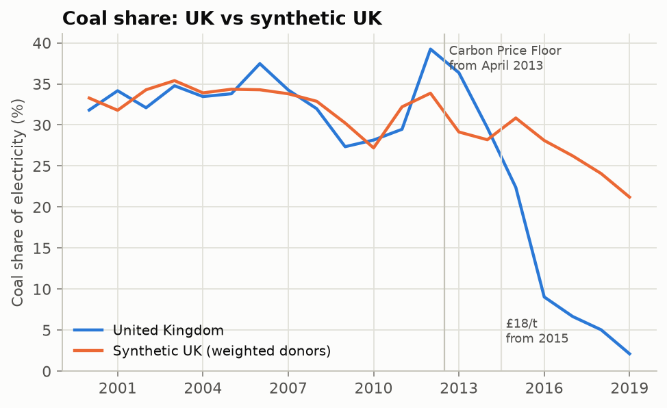
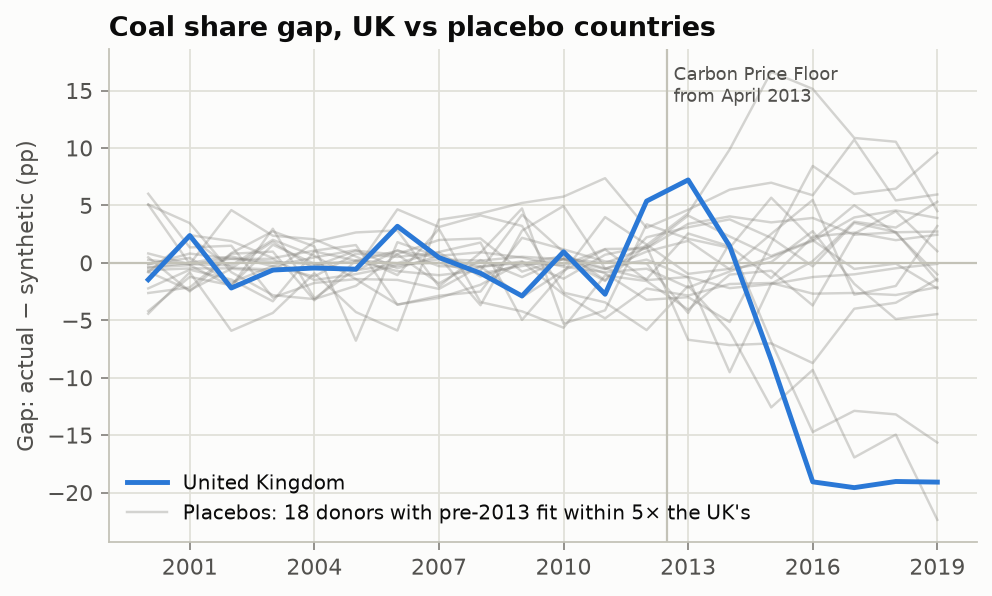
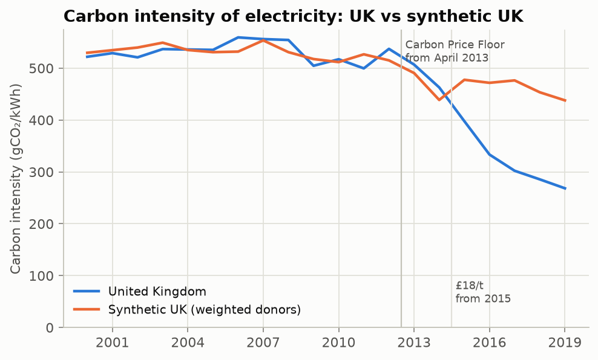

# Did the UK Carbon Price Floor push coal out of British power?

In April 2013 the UK added its own carbon tax on fossil fuels used for power
(Carbon Price Support), on top of the EU ETS price: £4.94 per tonne of CO₂,
£9.55 from April 2014, then £18.08 from April 2015, where it was frozen.
Coal's share of UK electricity fell from 39% in 2012 to 2% in 2019. How much
of that would have happened anyway?

There is no second UK to compare against, so this builds one: a **synthetic
control**, a weighted average of European countries chosen to track the UK
before 2013. After 2013, the gap between the real UK and the synthetic one is
the estimated effect.



## Result

| | Coal share of generation | Carbon intensity of electricity |
|---|---|---|
| Effect 2013–2017 (average) | **−7.7 pp** | **−70 gCO₂/kWh** (−15%) |
| Effect 2015–2019 (after the £18/t step) | **−17.0 pp** | **−146 gCO₂/kWh** (−32%) |
| Effect by year 2013 → 2019 | +7, +1, −8, −19, −20, −19, −19 | +16, +24, −80, −138, −174, −168, −170 |
| Pre-2013 fit (RMSPE) | 2.3 pp | 16 gCO₂/kWh |
| Placebo p-value (19 donors) | 0.20 (UK ranks 4th of 20) | 0.10 (UK ranks 2nd of 20) |

Converting the intensity gap with actual UK generation gives about
**240 MtCO₂ avoided over 2015–2019** relative to the synthetic UK.

**My reading:**

- **The timing matches the price.** Nothing happens in 2013–14, when the
  top-up was £5–10 per tonne. The gap opens in 2015, the year it reached £18,
  and stays at about 19 points. Coal-to-gas switching needs a carbon price
  large enough to overturn the fuel-cost difference, so a dose-response
  pattern like this is what the mechanism predicts.
- **The size is large and survives most robustness checks** (below). It is
  in the same direction as the published estimate for this policy:
  [Leroutier (2021)](https://www.parisschoolofeconomics.eu/publications-hal/carbon-pricing-and-power-sector-decarbonisation-evidence-from-the-uk),
  also using synthetic control, finds UK power emissions 26% below a
  synthetic UK in an average year of 2013–2017. My 2013–2017 average
  (15% on intensity) is smaller, mostly because my estimate is flat in
  2013–14.
- **The statistical evidence is moderate, not strong.** With 19 donor
  countries, the best attainable placebo p-value is 0.05. The UK's post/pre
  gap ratio is the 2nd-largest of 20 for carbon intensity and 4th for coal
  share. The Netherlands, which brought three new coal plants online around 2015 and went the
  other way, has a larger ratio. A careful conclusion is: *consistent with a
  large effect from 2015, but this design alone cannot rule out that some of
  it is other UK-specific change.*
- **What the design cannot separate:** UK-specific renewables support
  (offshore wind build-out under Contracts for Difference), coal plants that
  opted out of the Large Combustion Plant Directive closing by 2015, and the
  UK fleet's exposure to the 2015–16 fall in gas prices. Leroutier bounds
  these and attributes at least 80% of the fall to the tax. This repo does
  not attempt that decomposition.



## Robustness

| Check | Coal share, 2013–2017 | Carbon intensity, 2013–2017 |
|---|---|---|
| Main specification | −7.7 pp | −70 g/kWh |
| Ridge-augmented SCM (bias-corrected for imperfect pre-fit) | −10.5 pp | −77 g/kWh |
| Leave-one-out (drop each donor with weight > 1%) | −5.0 to −9.3 pp | −59 to −73 g/kWh |
| Placebo in time (fake policy in 2009, data to 2012) | +0.4 pp | −14 g/kWh |
| Pre-period 1990–2012 instead of 2000–2012 | −2.8 pp (pre-fit 4.4 pp) | −30 g/kWh (pre-fit 29) |
| Naive difference-in-differences vs donor average | −6.1 pp | −43 g/kWh |

The 1990–2012 run is the weakest result. It has to match the UK's "dash for
gas" after privatisation, which no mix of donors reproduces well (pre-fit
error doubles). I chose 2000–2012 as the main window before looking at the
post-2013 gaps, for that reason. Both are reported.



## Design

Fixed before looking at post-2013 results (see the docstring in `src/cpf/run.py`):

- **Treated unit:** United Kingdom. **Treatment year:** 2013.
- **Outcomes:** coal share of generation (%); carbon intensity of electricity (gCO₂/kWh).
- **Pre-period:** 2000–2012. **Post-period:** 2013–2019, stopping before
  COVID-19 and the UK's departure from the EU ETS.
- **Donor pool:** 19 European countries with complete data and an average coal
  share of at least 5% before 2013. A country with no coal cannot show the
  switch the policy targets.
- **Weights:** non-negative, summing to one, minimising pre-period error
  (Abadie, Diamond & Hainmueller 2010). For coal share they land on Croatia
  0.34, Portugal 0.27, Romania 0.19, Poland 0.11, Italy 0.04 and Slovenia 0.04.
- **Inference:** placebo-in-space. Every donor is treated in turn and the
  ratio of post- to pre-2013 RMSPE is ranked. This is also shown restricted
  to placebos whose pre-fit is within 5× the UK's.
- **Augmented SCM** (Ben-Michael, Feller & Rothstein 2021): a ridge
  correction for the remaining pre-period imbalance. The penalty is chosen by
  forecasting the last three pre-years for each donor.

## Run it

```bash
pip install -e ".[dev]"
# needs the warehouse from ../energy-emissions-data-pipeline (python scripts/build_warehouse.py there)
python -m cpf.run      # ~2 minutes; writes results/results.json and figures/
pytest                 # estimator tests: recovers known weights and effects, placebo rank, ridge bias correction
```

## Data

Our World in Data energy dataset (Ember and Energy Institute data, CC BY 4.0),
loaded and checked by the `energy-emissions-data-pipeline` project. Carbon Price Support rates
are from HM Treasury's Budget announcements, as summarised by
[CMS (2014)](https://cms.law/en/gbr/legal-updates/budget-2014-carbon-price-floor-frozen-at-2015-level-until-2020-extra-ccs-funding).
